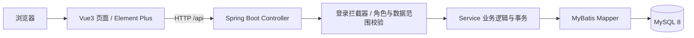
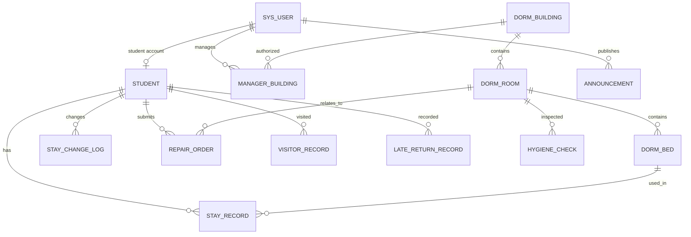
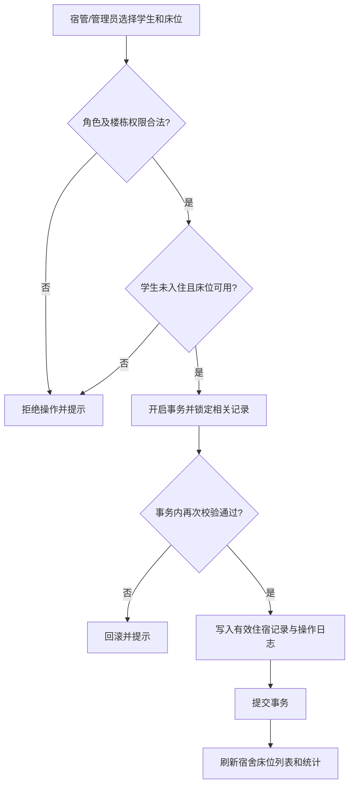
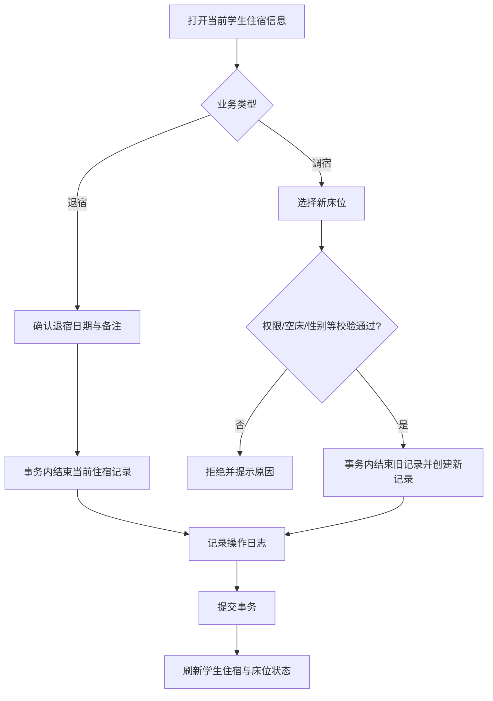
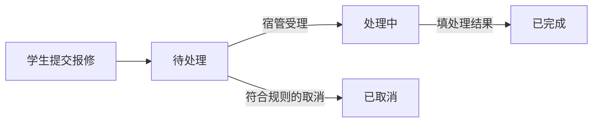

# 基于 JAVA的学生宿舍管理系统

> **毕业设计需求规格与18天实施计划书（V2.0｜导师意见修订版）**  
> 项目成员：3 人  
> 计划周期：18 天（约两周半）  
> 技术方案：Java + Spring Boot + Vue 3 + MySQL  
> 文档用途：需求评审、开发分工、过程管理、阶段验收、论文与答辩材料依据  
> 文档状态：**项目组讨论确认后执行；若院校有指定论文/文档模板，最终排版以学校要求为准**

---

## 0. 修订说明与执行原则

### 0.1 指导教师意见如何落实

| 指导意见 | 本版落实方式 | 验收证据 |
|---|---|---|
| 功能必须相对完善 | 纳入宿舍信息、学生入住/退宿/调宿、报修、来访、晚归、卫生、公告、统计等 **8 大业务域**，再加登录权限与学生档案 | 每个业务域都有真实数据表、可操作页面、后台接口和至少 1 个闭环用例 |
| 角色与权限清晰，三类角色 | 确定 **系统管理员、宿舍管理员、学生** 三类角色，细化菜单权限、接口权限和数据范围 | 权限矩阵、3 组演示账号、越权测试记录 |
| 技术熟悉、可靠、不过度追新 | 采用 Spring Boot 单体、Vue 3、MySQL；**不用微服务、Redis、MQ、工作流引擎等非必要技术** | 本地启动成功、构建可复现、项目依赖清单 |
| 文档规范齐全 | 必须交付需求规格、数据库设计、业务流程、接口清单、测试报告、部署说明、用户手册、论文和答辩 PPT | `docs/` 目录中的文档文件和对应版本记录 |

### 0.2 项目成功的定义

1. 三类账号登录后展示正确页面，且服务端能拒绝无权限访问。
2. 主要业务均可完成“**录入 → 保存 → 查询 → 更新/处理 → 状态变化 → 可追溯**”的闭环，不允许只有空页面或静态按钮。
3. 入住、退宿、调宿不会出现重复占床、一个学生同时占两个床位等数据错误。
4. 八大业务域和统计报表均能使用演示数据操作。
5. 有规范的需求、设计、流程、接口、测试、部署及答辩资料。
6. **D14 进入功能冻结，D15—D18 不再新增业务功能**；优先处理阻断演示的缺陷。

> **重要取舍**：导师要求“功能完善”应理解为“主要模块覆盖、流程可用、数据一致”，而不是要求每个模块都有复杂审批、消息推送、移动端和高级 BI。所有规定业务域都做一个可用的最小闭环，高级能力放在扩展项。

---

## 1. 项目背景、目标与边界

### 1.1 项目背景

高校学生宿舍存在房间和床位信息分散、入住与调宿操作难追踪、报修处理不透明、来访和晚归登记依赖纸质记录、卫生评比统计繁琐等问题。系统拟将上述工作集中到 Web 端，支持管理员管理、宿管日常办公、学生查看和申请，形成有数据可核查的管理流程。

### 1.2 项目目标

- **管理效率**：集中维护宿舍楼、房间、床位、学生住宿记录。
- **业务闭环**：覆盖入住、退宿、调宿、报修处理、来访登记、晚归记录、卫生检查、公告通知。
- **权限合理**：系统管理员管全局；宿舍管理员只管理被授权的宿舍楼；学生只能查看本人相关信息并提交规定类型业务。
- **数据可统计**：提供入住率、空床位数、报修状态、晚归次数、卫生检查结果等统计。
- **毕业设计可交付**：代码可运行、说明文档可追溯、演示脚本可复现。

### 1.3 建设范围

**纳入 V1.0（必须交付）**：

1. 登录与角色权限。
2. 学生档案管理。
3. 宿舍楼、房间、床位信息管理。
4. 学生入住、退宿、调宿与住宿历史。
5. 报修申请与处理。
6. 来访登记与离开确认。
7. 晚归记录与查询。
8. 卫生检查与评分。
9. 公告发布与查看。
10. 统计概览与基础报表。

**不纳入 V1.0（除非 D14 前全部必需功能已稳定）**：微信小程序、人脸识别、门禁硬件、短信/邮件推送、在线支付、地图定位、复杂多级审批、批量 Excel 导入导出、跨校区多租户、自动排宿算法、微服务、容器化集群。

### 1.4 业务假设

- 学生初始信息由系统管理员录入（不开放任何人自行注册）；演示时可预置学生账号。
- 每个学生在同一时刻最多有 **1 条有效住宿记录**；每个床位最多对应 **1 名在住学生**。
- 宿舍管理员被分配到一个或多个宿舍楼，只能管理范围内的数据。
- 报修由学生提交、宿管受理并维护状态；无需开发真实维修人员账号。
- 来访登记与晚归记录由宿管录入；学生仅能查看与自己相关的晚归记录及公告。
- 卫生评分采用 0—100 分；本版不开发复杂扣分规则和评比申诉。
- 统计报表采用数据库聚合结果，不必搭建独立数据仓库。

---

## 2. 技术选型与架构约束

### 2.1 固定技术方案（优先使用团队已有经验）

| 层次 | 技术 | 使用原因 / 注意事项 |
|---|---|---|
| 语言 | Java 17 | Spring Boot 3 常用稳定选择；如果团队已熟悉特定兼容版本，可统一版本 |
| 后端 | Spring Boot 3.x + Spring MVC | 单体项目、REST API、上手简单 |
| 持久层 | **MyBatis 或 MyBatis-Plus 二选一** | D1 确认团队更熟悉哪一个，后续不要混用两套风格 |
| 数据库 | MySQL 9.6 | 关系数据、事务、索引与统计查询 |
| 前端 | Vue 3 + Vite + Vue Router + Axios | 组件化页面、接口调用 |
| UI | Element Plus（如团队已熟悉） | 常见表格、对话框、表单和分页；不必自己造组件 |
| 状态管理 | Vue 原生响应式 / 简单共享状态 | 先不引入 Pinia；若成员熟悉且确有需要再选用 |
| 认证 | 服务端 Session + 登录拦截器 + BCrypt 密码哈希 | 同源部署、减少 JWT 学习与维护负担；必须在后端做权限校验 |
| 构建 | Maven、npm | 最简单的可复现构建方式 |
| 协作 | Git + GitHub / Gitee / 本地共享 Git 仓库 | 固定分支与提交规范；选你们已有的环境 |
| 流程图 | Markdown Mermaid / draw.io | 保留可编辑源文件，并在论文中导出图片 |

**技术冻结规则**：D1 确认 Java/Node/MySQL 版本及 ORM 方案；D3 后除修复阻断问题外，不更换主技术栈。

### 2.2 不做的技术复杂化

- 不拆微服务，不引入注册中心、消息队列和 Redis。
- 不为“技术先进”而引入不熟悉的权限框架、低代码引擎和复杂状态机。
- 不要求 Docker；允许通过 Maven + npm + MySQL 直接部署与演示。
- 可选图表用一两种简单柱状图 / 饼图；即使不用图表库，也必须能展示统计表格。

### 2.3 推荐系统架构



建议分层：`controller`（请求与响应）→ `service`（业务规则与事务）→ `mapper`（SQL）→ `database`。`entity`、`dto`、`vo`、`common`、`config` 按需组织，不做过度抽象。

### 2.4 推荐仓库结构

```text
dormitory-management/
├── backend/                    # Spring Boot
│   ├── pom.xml
│   └── src/main/
│       ├── java/.../
│       │   ├── controller/
│       │   ├── service/
│       │   ├── mapper/
│       │   ├── entity/
│       │   ├── dto/
│       │   ├── common/
│       │   └── config/
│       └── resources/
├── frontend/                   # Vue 3 + Vite
│   ├── package.json
│   └── src/
│       ├── api/
│       ├── router/
│       ├── views/
│       ├── components/
│       └── utils/
├── sql/
│   ├── schema.sql              # 建表与索引
│   ├── seed.sql                # 演示数据（脱敏虚构）
│   └── reset_demo.sql          # 可选：恢复演示场景
├── docs/
│   ├── 01-需求规格说明书.md
│   ├── 02-数据库设计说明书.md
│   ├── 03-核心业务流程.md
│   ├── 04-接口设计说明书.md
│   ├── 05-测试计划与报告.md
│   ├── 06-部署与运行手册.md
│   ├── 07-用户操作手册.md
│   └── assets/                 # ER图、流程图导出图、页面截图
├── README.md
└── .gitignore
```

---

## 3. 用户角色、权限与数据范围

### 3.1 角色定义

**R1 系统管理员（ADMIN）**：系统初始化、维护学生信息/宿舍资源、创建账号、分配宿管所管宿舍楼、查看全校业务与统计、发布全局公告。

**R2 宿舍管理员（MANAGER）**：查看授权楼栋的宿舍与学生，办理入住/退宿/调宿，处理授权楼栋报修，登记来访/晚归和卫生检查，查看所管楼栋统计与公告。

**R3 学生（STUDENT）**：查看本人档案与住宿信息，提交本人宿舍报修、查看处理进度、查看公告和本人晚归记录；不允许操作管理页面。

### 3.2 权限矩阵

说明：`✓` 可操作；`查看` 只读；`本人` 限本人；`授权楼` 限分配宿舍楼；`—` 不允许。

| 功能 / 操作 | 系统管理员 | 宿舍管理员 | 学生 |
|---|---|---|---|
| 登录、修改个人密码、退出 | ✓ | ✓ | ✓ |
| 用户账号与宿管楼栋授权 | ✓ | — | — |
| 学生档案增删改查 | ✓ | 查看（授权楼） | 本人查看 |
| 宿舍楼、房间、床位维护 | ✓ | 查看（授权楼） | 本人住宿查看 |
| 学生入住/退宿/调宿 | ✓ | ✓（授权楼） | 本人记录查看 |
| 报修提交 | 可代录 | ✓（授权楼，可代录） | 本人提交 |
| 报修受理、处理与结单 | ✓ | ✓（授权楼） | 本人查看 |
| 来访登记、离开确认 | ✓ | ✓（授权楼） | — |
| 晚归登记、修改 | ✓ | ✓（授权楼） | 本人查看 |
| 卫生检查录入、修改 | ✓ | ✓（授权楼） | 本人房间查看 |
| 公告发布、撤回 | ✓ | — | — |
| 公告列表与详情 | ✓ | ✓ | ✓ |
| 统计报表 | 全校 | 授权楼 | 个人首页简讯 |

### 3.3 权限实现规范

1. **前端菜单隐藏不等于权限控制**：每个后端接口都必须校验登录状态与角色。
2. **数据范围需在后端落实**：宿管查询带上服务端维护的授权楼栋集合，不接受前端传入任意楼栋就放行；编辑/处理接口同样必须校验。
3. **学生本人数据隔离**：从登录会话取得学生身份，不信任请求携带的 `studentId`。
4. 登录密码只保存 BCrypt 哈希；日志和接口响应不回传明文密码。
5. 失败登录、无权限、参数错误与服务器错误分别返回合理错误提示。
6. 管理员可重置账号密码；学生不可直接提升角色。

### 3.4 最小演示账号

| 账号类型 | 演示账号示例 | 演示内容 |
|---|---|---|
| ADMIN | admin | 跨楼栋信息、权限管理、统计、公告发布 |
| MANAGER A | manager_a | 1 号楼住宿与业务管理 |
| MANAGER B | manager_b | 2 号楼管理，用于证明楼栋数据隔离 |
| STUDENT | student_demo | 查看自己的床位、提交报修、查看公告 |

账号密码通过 `seed.sql` 或初始化脚本安全设置，**不把真实密码写入提交到公共仓库的文档中**。

---

## 4. 功能性需求规格（含验收标准）

> 下列 `FR-xx` 是需求编号，后续数据库设计、接口、测试用例、论文截图应能够对应到相同编号。

### 4.1 登录与账号权限（FR-01）

**目标**：三种角色登录、退出、密码管理、按角色控制页面和数据。

**功能点**：
- 管理员添加/禁用宿管或学生账号、重置密码、给宿管分配楼栋。
- 用户登录、退出、查看个人信息、修改密码。
- 登录后根据角色进入不同首页；无权限时返回 403。

**验收**：账号密码错误不能登录；禁用账号不能登录；学生直接访问管理 API 被拒绝；宿管 A 查询宿管 B 楼栋记录被拒绝。

### 4.2 学生信息管理（FR-02）

**功能点**：学号、姓名、性别、学院、班级、联系方式、账号状态维护；按学号/姓名查询；分页；详情；关联当前住宿信息。

**业务规则**：学号唯一；删除已有有效住宿记录的学生应被禁止（可用停用代替）；学号不允许随意修改。

**验收**：新增一名学生→能查询→能编辑联系方式→可以在入住页面选择该学生。

### 4.3 宿舍信息管理（FR-03）

**功能点**：宿舍楼管理、房间管理、床位管理；显示楼栋编号、名称、性别限制、楼层、房间号、床位号、启用状态、占用状态；按楼栋/楼层/空床位筛选。

**业务规则**：楼栋编号唯一；同楼栋房间号唯一；同房间床位号唯一；禁止删除已有入住记录关联的房间/床位；**占用状态以有效住宿记录为准，不手动编辑一个独立“是否入住”字段**。

**验收**：创建楼栋→创建房间→生成/新增床位→展示空床位；入住后床位变为已占用；退宿后恢复为空。

### 4.4 入住、退宿、调宿（FR-04：核心）

**入住**：管理员/宿管选择学生和空床位，校验学生未入住、床位启用且为空、楼栋性别规则，提交后生成有效住宿记录。

**退宿**：对当前在住学生发起退宿，填写退宿日期/备注，关闭当前住宿记录并释放床位，保留历史。

**调宿**：选择已入住学生和新的可用床位，在一个数据库事务中结束旧记录、创建新记录、写入变更日志；新旧床位状态同步反映。

**业务规则**：
- 一个学生只能同时在住一个床位；一张床位不能同时安排两名学生。
- 调宿目标床位不能与原床位相同，且宿管须有权操作涉及的楼栋（若跨楼栋，建议仅允许系统管理员办理，减少越权风险）。
- 入住、退宿、调宿涉及多次写操作必须使用 `@Transactional`；先锁定相关学生/床位记录并再次判断是否可用，避免并发操作。
- 不物理删除住宿历史；所有操作有操作者、时间和备注。

**验收**：
1. 同一学生重复入住被拒绝。
2. 两名学生分配同一床位，第二次被拒绝。
3. 调宿成功后旧床位释放、新床位占用，历史查询可见原记录。
4. 调宿失败时数据整体回滚，不会出现“两床都占”或“两床都空”的异常状态。

### 4.5 宿舍报修管理（FR-05）

**状态**：`待处理(PENDING)` → `处理中(PROCESSING)` → `已完成(COMPLETED)`；必要时支持 `已取消(CANCELLED)`（限尚未处理的申请）。

**功能点**：学生填写房间、报修类型、问题描述、联系方式；查看自己的工单状态；宿管查看负责楼栋工单、填写处理意见、更改状态和完成时间；按状态/日期筛选。

**业务规则**：学生只能对自己当前入住房间提交报修；已完成工单不得无理由回退；宿管不能处理其他楼栋工单。

**验收**：学生提交→宿管看到待处理→点击处理→标记完成→学生看到已完成及处理备注。

### 4.6 来访登记管理（FR-06）

**功能点**：宿管登记来访人姓名、联系方式（演示数据）、被访学生、来访原因、来访时间、预计离开时间；离开时补充实际离开时间；按楼栋/日期/状态查询。

**状态**：`在访(VISITING)` → `已离开(LEFT)`。

**业务规则**：被访学生须处于有效入住状态；宿管只能登记所属楼栋来访；离开时间不得早于到访时间；页面不存储真实身份证号码（毕设展示不需要）。

**验收**：录入来访登记→列表显示在访→确认离开→状态变为已离开且可查询。

### 4.7 晚归记录管理（FR-07）

**功能点**：宿管选择已入住学生，登记晚归日期、实际返回时间、晚归原因、备注；按学生/时间/楼栋查询；学生查看本人记录。

**业务规则**：晚归标准采用项目明确的固定阈值（例如 23:00，需在需求文档标明是演示规则）；只记录确认为晚归的情况；同一学生同一日期同一次晚归应避免重复录入。

**验收**：宿管登记→管理列表可查→学生端能看到该记录→其他学生看不到。

### 4.8 卫生检查管理（FR-08）

**功能点**：宿管选择所管房间，录入检查日期、分数（0—100）、检查说明、检查人；按楼栋/房间/月份查询；显示房间平均分；学生查看所在房间检查结果。

**业务规则**：检查分数在 0—100 范围；同房间同日期默认只保留 1 次正式检查（可修改结果）；记录关联检查人。

**验收**：录入一次检查→列表显示→修改评分→月度平均分正确更新→所属房间学生能查看。

### 4.9 公告通知管理（FR-09）

**功能点**：管理员发布标题、内容、发布时间、发布范围（全校 / 指定宿舍楼）；支持草稿与发布、撤回；宿管与学生查看对自己可见的公告。

**状态**：`草稿(DRAFT)` → `已发布(PUBLISHED)` → `已撤回(WITHDRAWN)`。

**业务规则**：仅管理员发布和撤回；学生只看到已发布且符合其当前宿舍楼范围的公告；暂不做已读回执和消息推送。

**验收**：管理员发布全校公告→三类用户可见；发布指定楼栋公告→只有相应宿管和楼栋学生可见；撤回后普通用户不可见。

### 4.10 首页统计与报表（FR-10）

**必做统计指标**：

| 指标 | 计算口径 | 展示方式 |
|---|---|---|
| 学生总数 | 有效学生记录数 | 数字卡片 |
| 床位总数 | 启用床位数 | 数字卡片 |
| 已住床位数 | 有效住宿记录对应的床位数 | 数字卡片 |
| 床位入住率 | 已住床位数 ÷ 启用床位数 × 100%（分母为 0 则显示 0%） | 百分比 |
| 待处理报修数 | 状态为 PENDING 的工单数 | 数字卡片 |
| 月度晚归次数 | 指定月份的有效晚归记录条数 | 统计表 |
| 月度卫生平均分 | 指定月份符合条件的检查记录分数平均 | 统计表 |

**权限与筛选**：管理员查看全校并按楼栋筛选；宿管仅看授权楼栋；学生只看个人首页信息，不看全校统计。

**验收**：新增入住后已住床位数和入住率变化；结单后待处理报修数减少（如果已由待处理改为处理中，待处理数应在受理时即减少）；筛选楼栋后统计范围正确；至少有 1 张按楼栋或月份汇总的报表。

**可选增强（有余力再做）**：简单柱状图、饼图、CSV 导出。不把复杂图表库配置当作必需验收条件。

---

## 5. 非功能需求与统一规范

| 编号 | 类别 | 可验证要求 |
|---|---|---|
| NFR-01 | 易用性 | 主要菜单有清晰导航；表单必填项和错误提示明确；危险操作二次确认 |
| NFR-02 | 性能 | 演示数据规模（约 100—300 名学生）下，常规列表/操作无明显卡顿；列表接口分页 |
| NFR-03 | 数据一致性 | 入住/退宿/调宿使用事务，禁止重复床位占用和重复有效入住 |
| NFR-04 | 安全 | 密码哈希；服务端鉴权；SQL 使用参数绑定；敏感字段最小化；不使用真实个人信息展示 |
| NFR-05 | 可靠性 | 数据库连接失败与异常请求有合理提示；关键操作不会写一半 |
| NFR-06 | 可维护性 | 统一命名、接口响应格式、异常处理、日志和 Git 提交规范 |
| NFR-07 | 可部署性 | 新电脑按照 README / 部署文档可完成数据库初始化和前后端启动 |
| NFR-08 | 可测试性 | 提供测试账号、脱敏演示数据、核心场景用例与截图/录屏证据 |

### 5.1 API 统一响应建议

```json
{
  "code": 0,
  "message": "success",
  "data": { "id": 1 }
}
```

约定：`code=0` 表示成功；业务失败返回清晰错误码或信息；登录未认证 HTTP 401、没有权限 HTTP 403、参数错误 HTTP 400、服务器异常 HTTP 500。前后端统一字段，不要同一项目出现多套返回格式。

### 5.2 开发及安全底线

- 所有新增/编辑接口校验必填项、长度、数值范围、状态流转。
- 不在 SQL 字符串中拼接前端传入参数；用预编译参数。
- 日志不得记录密码；演示数据尽量使用虚构姓名和号码。
- 使用 Session 时，本地开发通过 Vite `/api` 代理访问后端；生产演示优先同源部署，降低跨域与 Cookie 配置难度。
- 默认不对公网开放演示系统；如必须上线公网，需额外审查 HTTPS、CSRF、防暴力破解等安全要求。

---

## 6. 数据库设计（建议 13 张核心表）

> D2 交付完整 ER 图、字段数据字典、建表 SQL、索引和虚构演示数据。下面是必须覆盖的逻辑结构；精确字段类型在 D2 审核后固定。

### 6.1 表清单与关键字段

| 表名 | 中文名称 | 关键字段 / 说明 |
|---|---|---|
| `sys_user` | 系统用户 | `id` PK、`username` UNIQUE、`password_hash`、`role`、`status`、`student_id` 可空 |
| `student` | 学生档案 | `id` PK、`student_no` UNIQUE、`name`、`gender`、`college`、`class_name`、`phone`、`status` |
| `dorm_building` | 宿舍楼 | `id` PK、`building_no` UNIQUE、`building_name`、`gender_limit`、`status` |
| `manager_building` | 宿管楼栋授权 | `id` PK、`user_id` FK、`building_id` FK；`(user_id, building_id)` UNIQUE |
| `dorm_room` | 宿舍房间 | `id` PK、`building_id` FK、`room_no`、`floor_no`、`status`；`(building_id, room_no)` UNIQUE |
| `dorm_bed` | 床位 | `id` PK、`room_id` FK、`bed_no`、`status`；`(room_id, bed_no)` UNIQUE |
| `stay_record` | 住宿记录 | `id` PK、`student_id` FK、`bed_id` FK、`checkin_at`、`checkout_at`、`status`、`operator_id` |
| `stay_change_log` | 住宿操作日志 | `id` PK、`student_id`、`action_type`、`from_bed_id`、`to_bed_id`、`operator_id`、`operated_at`、`remark` |
| `repair_order` | 报修工单 | `id` PK、`student_id`、`room_id`、`category`、`description`、`status`、`handler_id`、`handle_remark`、时间字段 |
| `visitor_record` | 来访登记 | `id` PK、`student_id`（被访人）、`building_id`、`visitor_name`、`visitor_phone`、`purpose`、`arrive_at`、`leave_at`、`status` |
| `late_return_record` | 晚归记录 | `id` PK、`student_id`、`building_id`、`return_at`、`reason`、`remark`、`operator_id` |
| `hygiene_check` | 卫生检查 | `id` PK、`room_id`、`check_date`、`score`、`remark`、`inspector_id`；`(room_id, check_date)` UNIQUE |
| `announcement` | 公告 | `id` PK、`title`、`content`、`scope_type`、`building_id` 可空、`status`、`publisher_id`、`published_at` |

**说明**：上述共 **13 张核心表**（含宿管授权表、住宿操作日志）。不另做单独的“已入住床位表”，入住关系以 `stay_record.status=ACTIVE` 判定，减少重复维护。

### 6.2 主要实体关系（ER 图草案）



### 6.3 字段与数据规范

- 业务主键统一使用 `BIGINT`；一般字符串使用 `VARCHAR`，说明文本使用 `TEXT`。
- `created_at`、`updated_at` 建议用于主要业务表，时间统一由服务端写入。
- 性别、角色、业务状态必须固定取值范围，并在文档列出数据字典。
- 宿舍与学生使用逻辑启用/停用；**已存在业务引用时不能直接物理删除历史记录**。
- 床位是否被占用由有效住宿记录判断，床位表 `status` 仅表达“启用/停用”，不表达“已占/空闲”。
- 对 `stay_record(student_id, status)`、`stay_record(bed_id, status)`、`repair_order(room_id, status)`、日期范围查询字段建立适当索引。
- **MySQL 8 普通 UNIQUE 约束不能直接实现“仅 ACTIVE 唯一”**：D8 必须用事务、行锁、存在性校验保障单人单床与单床单人，不应错误声称普通联合唯一键可以替代这一校验。

### 6.4 数据一致性与事务设计

**入住**：校验权限 → 锁定学生记录 → 锁定目标床位记录 → 查询学生是否已住与床位是否占用 → 插入有效住宿记录 → 写操作日志 → 提交。

**退宿**：校验权限 → 锁定学生及关联床位 → 结束当前有效住宿记录 → 写日志 → 提交。

**调宿**：校验源/目标楼栋权限 → 锁定学生与两个床位（按床位 ID 顺序锁定，降低死锁概率）→ 再次校验目标空闲 → 结束原记录 → 新增有效记录 → 写变更日志 → 提交。事务失败整单回滚。

> 若希望数据库也强制约束有效入住唯一性，可在后续阶段评估“生成列 + 唯一索引”的方案；18 天内优先保证服务端事务正确并完成并发/重复操作测试。

### 6.5 统计数据来源

统计接口从 `student`、`dorm_bed`、`stay_record`、`repair_order`、`late_return_record` 和 `hygiene_check` 查询聚合，**不额外维护可变统计汇总表**；以减少同步错误。

---

## 7. 核心业务流程设计

### 7.1 学生入住流程



### 7.2 退宿/调宿流程



### 7.3 报修处理流程



### 7.4 来访、晚归、卫生、公告流程

| 业务 | 发起者 | 标准流程 | 最终可见结果 |
|---|---|---|---|
| 来访 | 宿管 | 选择被访学生 → 填写来访登记 → 确认离开 | 访客状态、到访/离开时间可查 |
| 晚归 | 宿管 | 选择在住学生 → 填写晚归时间与原因 → 保存 | 学生本人和授权宿管能查询 |
| 卫生检查 | 宿管 | 选择房间 → 录入评分 → 保存/修正 | 所在房间学生可见，统计更新 |
| 公告 | 管理员 | 编辑草稿 → 设置范围 → 发布/撤回 | 对应范围内用户可见发布内容 |

### 7.5 建议保留的业务设计证据

- 用例图：3 类角色分别能做什么。
- ER 图：核心实体、主键外键和多对多授权关系。
- 业务流程图：入住、退宿/调宿、报修三张必须有。
- 关键页面截图：权限差异、床位变化、处理状态变化、统计变化。
- 如学校要求，再增加时序图（推荐只画入住/调宿两个关键场景）。

---

## 8. 页面结构与接口设计

### 8.1 推荐页面清单

| 角色/区域 | 页面 | 核心展示及操作 |
|---|---|---|
| 公共 | 登录页、个人中心 | 登录、退出、修改密码 |
| 管理端 | 首页概览 | 床位统计、报修、晚归、卫生摘要 |
| 管理端 | 学生管理 | 列表、搜索、新增、编辑、详情 |
| 管理端 | 楼栋/房间/床位管理 | 树/列表、楼层筛选、空床位标记 |
| 管理端 | 住宿管理 | 当前入住、入住、退宿、调宿、历史 |
| 管理端 | 报修管理 | 工单列表、详情、处理状态 |
| 管理端 | 来访管理 | 来访登记、确认离开、搜索 |
| 管理端 | 晚归管理 | 登记、按时间查询 |
| 管理端 | 卫生管理 | 检查录入、查询、月度平均分 |
| 管理端 | 公告管理 | 新建、发布、撤回、列表 |
| 管理端 | 报表统计 | 楼栋入住率、报修/晚归/卫生统计 |
| 系统管理员 | 用户与楼栋授权 | 账号管理、宿管楼栋授权 |
| 学生端 | 我的住宿 | 楼栋、房间、床位、入住信息 |
| 学生端 | 我的报修 | 新建报修、查看进度 |
| 学生端 | 公告/晚归/卫生 | 阅读可见公告、查看本人或所在房间记录 |

**UI 复用原则**：同一张管理端布局（菜单栏 + 顶栏 + 内容区），列表页统一“搜索表单 + 表格 + 分页 + 弹窗”。无须做三套完全独立的复杂界面。

### 8.2 核心 API 清单（建议命名，D3 冻结）

| 业务 | HTTP | URL | 说明 | 允许角色 |
|---|---|---|---|---|
| 账号 | POST | `/api/auth/login` | 登录 | 公开 |
| 账号 | POST | `/api/auth/logout` | 退出 | 已登录 |
| 账号 | GET | `/api/auth/me` | 当前用户与角色 | 已登录 |
| 账号 | PUT | `/api/auth/password` | 修改密码 | 已登录 |
| 账号 | GET/POST/PUT | `/api/users`、`/api/users/{id}` | 账号管理 | ADMIN |
| 账号 | PUT | `/api/users/{id}/buildings` | 宿管授权楼栋 | ADMIN |
| 学生 | GET/POST/PUT | `/api/students`、`/api/students/{id}` | 学生档案管理 | ADMIN；宿管只读 |
| 宿舍 | GET/POST/PUT | `/api/buildings`、`/api/buildings/{id}` | 楼栋维护 | ADMIN；宿管只读 |
| 宿舍 | GET/POST/PUT | `/api/rooms`、`/api/rooms/{id}` | 房间维护 | ADMIN；宿管只读 |
| 床位 | GET/POST/PUT | `/api/beds`、`/api/beds/{id}` | 床位列表与维护 | ADMIN；宿管只读 |
| 住宿 | POST | `/api/stays/check-in` | 入住 | ADMIN/MANAGER |
| 住宿 | POST | `/api/stays/check-out` | 退宿 | ADMIN/MANAGER |
| 住宿 | POST | `/api/stays/transfer` | 调宿 | ADMIN/MANAGER |
| 住宿 | GET | `/api/stays`、`/api/stays/history` | 当前住宿与历史 | 按角色限制 |
| 报修 | POST/GET | `/api/repairs` | 提交/查询报修 | 三类角色（范围各异） |
| 报修 | PUT | `/api/repairs/{id}/status` | 处理工单 | ADMIN/MANAGER |
| 来访 | POST/GET | `/api/visitors` | 登记/查询 | ADMIN/MANAGER |
| 来访 | PUT | `/api/visitors/{id}/leave` | 确认离开 | ADMIN/MANAGER |
| 晚归 | POST/GET | `/api/late-returns` | 登记/查询 | 管理端写；学生仅本人读 |
| 卫生 | POST/GET/PUT | `/api/hygiene-checks`、`/api/hygiene-checks/{id}` | 录入/查询/修改 | 管理端写；学生仅相关房间读 |
| 公告 | GET/POST/PUT | `/api/announcements`、`/api/announcements/{id}` | 查询/编辑 | 发布修改仅 ADMIN |
| 公告 | PUT | `/api/announcements/{id}/publish` | 发布 | ADMIN |
| 公告 | PUT | `/api/announcements/{id}/withdraw` | 撤回 | ADMIN |
| 报表 | GET | `/api/statistics/overview` | 概览 | ADMIN/MANAGER |
| 报表 | GET | `/api/statistics/by-building` | 楼栋汇总 | ADMIN/MANAGER |
| 报表 | GET | `/api/statistics/monthly` | 月度汇总 | ADMIN/MANAGER |

> **实施要求**：表内部分接口用一个单元格列出 GET/POST/PUT，并不表示它们拥有相同请求参数；在正式 `04-接口设计说明书.md` 中必须逐个写请求、响应、权限、异常及示例。

### 8.3 D3 必须固定的前后端接口约定

- 基础前缀 `/api`，请求/响应字段采用 `camelCase`，数据库列采用 `snake_case`。
- 时间统一 ISO 风格字符串，如 `2026-11-18 23:05:00`；日期用 `YYYY-MM-DD`。
- 分页统一 `page`（从 1 开始）、`pageSize`、`total`、`records`。
- 后端通过会话获取用户身份，所有数据范围按角色过滤。
- 统一错误反馈，不让前端直接显示 Java 异常堆栈。

---

## 9. 团队组织与分工

### 9.1 人员角色（按能力而不是平均切分业务）

| 成员 | 定位 | 负责内容 | 必须独立说明的技术点 |
|---|---|---|---|
| **A（已有 Java 基础）** | 后端与数据库负责人 | 后端骨架、数据库建模、登录权限、入住退宿调宿、住宿事务、主要后端 API、集成打包 | Controller/Service/Mapper 分层、SQL、事务和权限 |
| **B（有前端基础）** | 前端与联调负责人 | Vue 页面布局、路由、Axios、基础管理页面、宿管业务页面、报表、与 A 联调 | Vue 组件、路由守卫、表单提交、API 调用 |
| **C（零基础）** | 文档、测试与简单功能负责人 | 跟随学习、需求规格、ER/流程图整理、初始化演示数据、测试用例、部署/操作手册；在 B 的指导下完成公告展示、卫生登记或来访表单中的**一个小页面** | 能讲解自己做的页面、接口请求和一条核心业务流程 |

**公平性原则**：C 的代码量可以少，但必须有可验证的独立贡献；A/B 负责指导和代码审核，不能让 C 最后只会读 PPT。

### 9.2 模块责任分配（R=主要负责，S=支持，T=验收测试）

| 需求模块 | A | B | C | 交付负责人 |
|---|---|---|---|---|
| 登录权限 FR-01 | R | S | T | A |
| 学生档案 FR-02 | R（接口） | R（页面） | T | A/B |
| 宿舍信息 FR-03 | R（接口） | R（页面） | T | A/B |
| 住宿业务 FR-04 | R | R | T | A |
| 报修 FR-05 | R（接口） | R（页面） | T | A/B |
| 来访 FR-06 | R（接口） | S（页面） | S（表单/测试） | B |
| 晚归 FR-07 | R（接口） | R（页面） | T | B |
| 卫生 FR-08 | R（接口） | S（复用布局） | S（简单页面/测试） | B |
| 公告 FR-09 | R（接口） | S（管理页面） | R（学生展示页） | C |
| 统计 FR-10 | R（SQL） | R（页面） | T（核数） | B |
| 需求/设计/流程文档 | S（技术校审） | S（截图） | R（汇总） | C |
| 测试/部署/答辩 | R（部署） | R（演示） | R（测试与材料） | 三人 |

### 9.3 合作规则

- **每天 15—20 分钟站会**：昨天完成什么、今天做什么、卡住什么；卡住超过 2 小时就求助。
- `main` 放可运行版本，开发分支示例：`feature/auth`、`feature/stay`、`feature/visitor-page`；每天至少一次提交。
- 开始写代码前先在接口文档确定参数与返回值，避免前端和后端各写各的。
- 每天下班前将可运行代码合入测试分支；**不要等全部写完才首次联调**。
- C 每天同步测试记录；A/B 每天审核一次 C 的技术任务。
- 遇到阻断问题先保证主要场景可运行，不在小问题上无限投入。

---

## 10. 18 天逐日任务安排（精确到人）

> 按每天可有效投入约 5—7 小时规划，若三人白天还有课程/工作，请减少可选增强，并把 D14 功能冻结坚持到底。

| 天数 | A：后端/数据库 | B：前端/联调 | C：零基础/文档/测试 | 当日验收物 |
|---|---|---|---|---|
| **D1** | 明确表结构与权限策略、选定 ORM | 页面清单、低保真原型、统一组件方案 | 整理导师意见、需求编号、任务看板；学习 Git 基本命令 | V1 需求范围、分工、技术冻结 |
| **D2** | 设计 13 表 ER/主外键、编写 `schema.sql` | 登录/管理布局原型，定义页面路由 | 完成需求说明书初稿、整理 ER 图与数据字典 | ER 草图、数据库初稿、页面原型 |
| **D3** | 创建 Spring Boot 工程、连库、统一响应/异常 | 创建 Vue 工程、路由、Axios、Vite 代理 | 独立完成环境安装/启动记录，编写 API 清单模板 | 前后端互通，3 人能启动 |
| **D4** | 登录、退出、Session、BCrypt、拦截器 | 登录页面、菜单按角色展示 | 准备角色账号、登录/越权测试 | 三类账号能正确登录 |
| **D5** | 用户账号、宿管楼栋授权、学生 CRUD | 管理端布局、学生管理列表/弹窗 | 测试学生 CRUD 与账号权限，补接口文档 | 学生/授权管理可用 |
| **D6** | 楼栋/房间/床位 CRUD 与唯一性校验 | 楼栋、房间、床位页面 | 虚构学生和宿舍初始数据、数据库字典 | 空床位查询可用 |
| **D7** | 入住 API、有效入住查询、事务/锁 | 入住对话框、可用床位选择、住宿列表 | 执行重复入住、床位冲突测试 | **第一次入住闭环** |
| **D8** | 退宿、调宿 API、历史记录与操作日志 | 退宿/调宿页面及提示 | 编写住宿业务流程图与异常测试 | **入住/退宿/调宿全闭环** |
| **D9** | 报修后端、状态流转与权限 | 学生报修页、宿管报修处理页 | 报修测试、熟悉 Vue 单文件组件 | 报修完整闭环 |
| **D10** | 来访、晚归后端接口 | 来访与晚归管理页（复用表格/弹窗） | 负责一个简单表单局部组件、测试数据 | 来访+晚归可录入查询 |
| **D11** | 卫生、公告后端接口 | 卫生管理页、公告管理页 | 独立完成学生公告列表/详情（B 代码评审） | 卫生+公告完整闭环 |
| **D12** | 概览与报表 SQL，修权限漏洞 | 首页统计、报表列表、学生端整合 | 核算报表数据、补缺失接口文档 | **所有核心模块首次贯通** |
| **D13** | 修入住/权限/状态流转等 P0 缺陷 | 修页面表单与流程错误 | 执行全套测试，记录缺陷编号与截图 | 主要闭环通过第一轮测试 |
| **D14** | 修剩余 P0/P1、制作可启动构建 | 统一页面体验、解决联调问题 | 回归测试、检查文档覆盖、测试报告初稿 | **功能冻结，准备演示版本** |
| **D15** | 准备可运行 Jar、初始化 SQL、部署脚本 | 构建 Vue 页面、演示全流程 | README、部署手册、初始化与重置步骤 | 新环境按文档能启动 |
| **D16** | 检查技术章节、补关键 SQL/代码说明 | 录制截图、绘制页面结构图 | 定稿需求、ER、业务流程、接口、测试文档 | 文档清单基本齐全 |
| **D17** | 准备数据库、事务、权限问题答辩 | PPT、系统演示串场、页面最终检查 | 操作手册、答辩讲稿、计时演练 | 一次不看代码的完整演示 |
| **D18** | 最终代码/数据库备份、部署复验 | 演示机器/浏览器检查、PPT 导出 | 文档排版和归档、提交清单核对 | **系统、源码、SQL、文档、PPT 全部交付** |

### 10.1 四个阶段的硬性里程碑

| 里程碑 | 截止 | 不达标处理方式 |
|---|---|---|
| M1：环境和设计冻结 | D3 | 暂停新需求，先解决项目启动问题 |
| M2：核心住宿业务可用 | D8 | A/B 共同攻坚入住/调宿；其他页面先用简单表单 |
| M3：全部业务域贯通 | D12 | 保留每个模块最小闭环，取消高级筛选/图表/导出 |
| M4：功能冻结并通过关键测试 | D14 | 不再添加需求，集中修复阻断答辩的问题 |

### 10.2 每日完成定义（Definition of Done）

某任务只有同时符合以下条件才标记为“完成”：

- 后端接口可以被 Postman / curl 或前端真实调用。
- 数据真实存入 MySQL，刷新页面仍然存在。
- 前端至少支持新增、查看和必要的状态变更。
- 已通过至少 1 个正常用例与 1 个异常/越权用例。
- 代码已提交、接口文档同步更新、没有阻断性错误。

---

## 11. 测试计划与验收用例

### 11.1 测试策略

**测试层次**：模块自测 → 前后端接口联调 → 完整业务流程测试 → 权限/异常测试 → 部署复现测试。C 主持测试记录，A/B 负责修复对应模块。

**优先级**：P0=无法登录、数据错乱、重要业务不可用/越权；P1=主要模块功能不完整；P2=样式/提示/可选操作问题。D14 前 P0 必须清零，P1 尽量清零。

### 11.2 关键测试清单

| 用例编号 | 对应需求 | 操作与预期 | 优先级 |
|---|---|---|---|
| TC-01 | FR-01 | 管理员/宿管/学生分别登录，菜单与角色匹配 | P0 |
| TC-02 | FR-01 | 学生直接请求账号管理 API，返回 403 | P0 |
| TC-03 | FR-01 | 宿管 A 查询宿管 B 的业务数据，拒绝或不返回越权数据 | P0 |
| TC-04 | FR-02 | 新增/修改/查询学生，学号重复被拒绝 | P1 |
| TC-05 | FR-03 | 新增楼栋/房间/床位，编号重复被拒绝 | P1 |
| TC-06 | FR-04 | 未入住学生入住空床位成功；房间状态和统计更新 | P0 |
| TC-07 | FR-04 | 同一学生二次入住被拒绝 | P0 |
| TC-08 | FR-04 | 同一床位重复分配被拒绝 | P0 |
| TC-09 | FR-04 | 退宿后床位恢复空闲、住宿历史保留 | P0 |
| TC-10 | FR-04 | 调宿成功：旧床位释放、新床位占用、日志可查 | P0 |
| TC-11 | FR-04 | 调宿目标被占用时整单失败，旧住宿不变 | P0 |
| TC-12 | FR-05 | 学生报修 → 宿管处理 → 学生查询结果 | P1 |
| TC-13 | FR-06 | 来访登记 → 确认离开 → 记录可查 | P1 |
| TC-14 | FR-07 | 晚归登记成功，学生只能看本人记录 | P1 |
| TC-15 | FR-08 | 卫生评分 0/100 合法，101 和负数被拒绝；月平均分正确 | P1 |
| TC-16 | FR-09 | 全校公告可见；指定楼栋公告只在指定范围可见 | P1 |
| TC-17 | FR-09 | 草稿与撤回公告不出现在学生端 | P1 |
| TC-18 | FR-10 | 入住/退宿前后床位入住率与实际 SQL 计算一致 | P0 |
| TC-19 | FR-10 | 宿管统计仅覆盖授权楼栋 | P1 |
| TC-20 | NFR-07 | 按部署文档在另一台电脑重建数据库并启动项目 | P0 |

**附加重点**：有条件时，使用两组会话快速重复提交同一空床位入住，检查后端事务是否挡住冲突。测试报告要保留截图、输入参数、实际结果、结论与缺陷处理记录。

### 11.3 验收清单（答辩前逐项打勾）

- [ ] 三类角色均可正常登录、退出、改密码。
- [ ] 系统管理员可创建账号并授权宿管楼栋。
- [ ] 宿管不能处理未授权楼栋业务，学生不能查看他人个人记录。
- [ ] 学生档案、楼栋、房间、床位增删改查及查询可用。
- [ ] 入住、退宿、调宿完整可用并有历史与事务校验。
- [ ] 报修提交、处理、查看状态的闭环可演示。
- [ ] 来访登记与离开确认可用。
- [ ] 晚归登记与本人查询可用。
- [ ] 卫生检查评分、房间查询与月统计可用。
- [ ] 公告发布、范围控制与撤回可用。
- [ ] 入住率、维修、晚归、卫生报表数据准确。
- [ ] SQL 初始化脚本、演示数据与启动文档齐全。
- [ ] 所有 P0 测试通过，无影响演示的严重错误。
- [ ] 需求、数据库、核心流程、接口、测试、部署、使用说明均归档。
- [ ] PPT 演练完整且三人均能回答自己负责部分。

---

## 12. 必须提交的规范文档

> **文档与代码同等重要**。建议采用“开发中持续更新”，不要最后两天才从零补文档。

| 文档 | 主要章节 / 必填内容 | 负责人 | 首版 / 定稿 |
|---|---|---|---|
| `01-需求规格说明书.md` | 背景、目标、三类角色、功能清单、FR 编号、业务规则、非功能需求、验收标准 | C 主笔、A/B 审核 | D2 / D16 |
| `02-数据库设计说明书.md` | 概念/逻辑/物理设计、ER 图、13 表、字段类型与长度、PK/FK、唯一性与索引、数据字典 | A 主笔、C 整理 | D2 / D16 |
| `03-核心业务流程.md` | 入住、退宿、调宿、报修、来访、晚归、卫生、公告流程；状态变更与异常处理 | C 绘制、A 校验 | D8 / D16 |
| `04-接口设计说明书.md` | URL、方法、角色、入参/出参、响应示例、错误码、数据范围要求 | A 主笔、B/C 补充 | D3 / D16 |
| `05-测试计划与报告.md` | 测试环境、测试用例编号、前置条件、测试步骤、预期/实际、截图、缺陷关闭记录 | C 主笔、A/B 修复签收 | D7 / D16 |
| `06-部署与运行手册.md` | JDK/Node/MySQL 版本、建库、初始化、配置、启动/构建、演示账号说明、常见问题 | A 主笔、C 复验 | D15 / D16 |
| `07-用户操作手册.md` | 管理员/宿管/学生三套操作路径、关键截图、常见问题 | C 主笔、B 截图 | D15 / D16 |
| `README.md` | 项目简介、功能、技术栈、目录、快速启动、截图、团队分工 | A 汇总 | D3 / D16 |
| 毕业论文（按学校模板） | 摘要、绪论、需求分析、总体设计、数据库设计、系统实现、测试、总结、参考文献 | 三人按学校规定完成各自材料 | D16 起整合；学校截稿时间优先 |
| 答辩 PPT 与演示脚本 | 背景目标、架构、功能、ER、业务流程、关键难点、测试、总结、演示路线 | B 主持、三人参与 | D17 / D18 |

### 12.1 文档统一规范

1. 统一名称、章节编号、版本号、编写日期、成员和变更记录。
2. 每个功能 `FR-xx` 至少对应一个接口或操作点、一个验收用例；关键功能必须能指向数据库表。
3. 重要图表应有图号、标题和来源，论文中使用导出的清晰图片（不要依赖评阅老师支持 Mermaid）。
4. 截图使用相同的演示数据及账号，避免一张图出现不同学生/房间造成矛盾。
5. 数据库字段说明应包含字段名、类型、是否为空、默认值、约束、含义。
6. 接口文档必须标明调用者角色和后端数据权限限制。
7. 测试报告必须写实际结果和缺陷，不只写“通过”；缺陷要有修改和回归证据。
8. 论文禁止虚构性能数据、测试结果或夸大系统功能，实际实现与文字描述必须一致。

### 12.2 需求可追溯样例

| 需求 | 设计对象 | API | 测试 | 截图/证据 |
|---|---|---|---|---|
| FR-04 学生调宿 | `stay_record`、`stay_change_log`、`dorm_bed` | `POST /api/stays/transfer` | TC-10、TC-11 | 调宿前后床位状态、住宿历史 |
| FR-05 报修处理 | `repair_order` | `POST /api/repairs`、`PUT /api/repairs/{id}/status` | TC-12 | 学生提交与宿管处理页面 |
| FR-09 公告范围 | `announcement`、`manager_building` | `GET /api/announcements` | TC-16、TC-17 | 不同角色/楼栋的公告列表 |

---

## 13. 零基础成员 C 的专项学习与交付路径

**目标不是两周内学会全部 Java 和 Vue，而是能够独立完成一个简单功能，并解释系统数据流。**

| 阶段 | 学习重点 | 立即实践 | 可交付成果 |
|---|---|---|---|
| D1—D3 | Git 克隆/提交、文件目录、MySQL 表概念、前后端是什么 | 跟着 README 启动系统、运行 SQL、用浏览器调接口 | 本地启动截图、环境记录 |
| D4—D6 | HTTP GET/POST、JSON、Vue `.vue` 页面结构、表格/表单 | 用模拟数据搭一个公告列表或简单表单 | 可显示的静态组件 |
| D7—D9 | Axios、后端接口返回格式、字段映射、测试方法 | 把模拟数据替换成接口数据，整理测试用例 | 真实接口调用和截图 |
| D10—D12 | 一个独立小功能、错误提示和状态管理 | 完成学生公告列表/详情；配合测试来访/卫生功能 | 已合入项目的组件与测试记录 |
| D13—D15 | 缺陷复现、测试报告、部署说明 | 逐条执行关键用例，按文档重新部署 | 完整测试证据和手册 |
| D16—D18 | 功能讲解、流程图、答辩表达 | 讲解“点击按钮→接口→数据库→页面刷新” | 能独立说明贡献、完成演示 |

**C 的最低技术验收**：能解释自己写的 Vue 页面从哪里请求数据、后端返回什么、在哪张数据库表存储；能说明一条入住/报修业务如何流转。A/B 应提前 2—3 天安排模拟提问。

---

## 14. 风险、延期与范围控制

### 14.1 风险清单

| 风险 | 预警信号 | 应对策略 |
|---|---|---|
| 核心业务过于复杂 | D7 仍无法入住、或重复占床 | A/B 优先攻克事务与基本页面，冻结次要界面美化 |
| 功能多、时间短 | D10 仍未完成来访/晚归 | 所有次要模块统一使用“表格 + 弹窗 + 状态字段”最简单实现 |
| 零基础成员跟不上 | D6 仍不能启动或看懂接口 | 将其独立开发任务收缩到公告查看页，增加测试/文档任务，不安排关键事务代码 |
| 前后端接口不一致 | 同一字段存在多种命名、频繁联调失败 | D3 冻结接口字段，修改必须同步文档和负责人 |
| 数据错乱或越权 | 宿管查到别的楼栋、调宿后双重占床 | 优先修复，不以“演示时不点这里”代替解决 |
| 数据库/电脑故障 | 仅一台电脑有唯一副本 | 每日远程/移动盘备份 Git 和 SQL，保留稳定演示版本 |
| 文档最后缺失 | D10 仍无 ER/流程/测试材料 | C 每日更新，D12 开始核对文档清单 |
| 导师临时提出新需求 | D12 后要求加复杂功能 | 记录为后续版本，先保障已确认的 8 大业务域和答辩 |

### 14.2 延期时删什么，不删什么

**绝对不能删**：三类角色与数据隔离、宿舍管理、入住/退宿/调宿、报修闭环、来访、晚归、卫生、公告、基础统计、核心文档。

**优先简化**：

1. 高级搜索改为日期/楼栋/状态三个基础条件。
2. ECharts 图表改为清晰的统计卡片和聚合表格。
3. Excel 导出、批量导入、消息已读、复杂筛选全部移入未来计划。
4. 美观动画、暗色主题、手机端完整适配暂不做。
5. 业务表单复用统一组件，不开发复杂审批链。

**时间底线**：D12 若还有未贯通的业务域，优先完成该模块“新增 + 查询 + 状态/修改”最短链路；D14 禁止新增功能。

---

## 15. 项目交付与答辩计划

### 15.1 最终交付清单

```text
[ ] 可运行的前端源码 frontend/
[ ] 可运行的后端源码 backend/
[ ] 完整 MySQL 建表 SQL、索引与演示数据 sql/
[ ] 需求规格说明书
[ ] 数据库设计说明书、ER 图与数据字典
[ ] 核心业务流程图及说明
[ ] 接口设计说明书
[ ] 测试计划、测试用例、测试记录和缺陷关闭记录
[ ] 部署与运行手册
[ ] 用户操作手册
[ ] README 与项目目录说明
[ ] 毕业论文（按学校要求）
[ ] 答辩 PPT 与关键演示截图
[ ] 一份“稳定可运行版本”的 Git 标签或压缩备份
```

### 15.2 6—8 分钟的推荐演示顺序

| 时间（参考） | 操作 | 展示目标 |
|---|---|---|
| 0:00—0:45 | 展示登录界面、系统简介与三类角色 | 系统范围与权限清楚 |
| 0:45—1:45 | 管理员查看学生/楼栋/床位 | 数据关联与宿舍资源管理 |
| 1:45—3:15 | 宿管执行入住→调宿→退宿，查看历史 | **核心业务与事务逻辑** |
| 3:15—4:15 | 学生提交报修→宿管处理 | 业务闭环 |
| 4:15—5:15 | 宿管登记来访、晚归、卫生检查 | 导师要求的日常业务覆盖 |
| 5:15—6:15 | 管理员发布公告、学生查看 | 通知功能与范围权限 |
| 6:15—7:00 | 展示入住率与月度统计 | 报表数据可核对 |
| 7:00—8:00 | 权限演示及数据库/流程图 | 系统设计与安全说明 |

> 现场演示不要从零创建全部数据。提前准备好 1 名“未入住学生”、2 张空床位、1 条待处理报修、1 条未离开的访客记录。演示完能够用 `reset_demo.sql` 或重新导入演示数据恢复环境。

### 15.3 三人答辩讲解建议

- **A**：系统架构、数据库、Session 认证、楼栋数据权限、入住/调宿事务与并发校验。
- **B**：Vue 组件、路由、表单与接口联动、业务页面交互、统计报表。
- **C**：需求与业务流程、测试用例、演示数据、自己实现的小页面、部署说明。

### 15.4 指导教师可能会问的问题

1. 为什么选择 Spring Boot + Vue 3 + MySQL？为什么不做微服务？
2. 为什么必须有三种角色？宿管和系统管理员权限有什么区别？
3. 如何保证“一个学生只住一个床位、一个床位只住一个学生”？
4. 调宿过程中，如果更新了一半失败，会怎么样？
5. 为什么床位占用状态不直接设计成可以修改的字段？
6. 宿管是否能查看和处理其他楼栋的数据？怎样在后端防止？
7. 报修有哪些状态，为什么这样设计？
8. 入住率如何计算？统计口径如何验证？
9. 数据库表之间主要有哪些一对多关系？
10. 如何证明软件经过测试，而不是只展示静态界面？

---

## 16. D1 团队启动会清单（马上执行）

会议建议控制在 45—60 分钟，当天明确以下决定：

1. **三人身份**：谁是 A、B、C？每人每天大约有多少时间可投入？
2. **技术定版**：确认 JDK/Node/MySQL 版本、MyBatis 还是 MyBatis-Plus、是否沿用已有 Vue 模板。
3. **需求确认**：逐条过 FR-01 至 FR-10，确定每个业务域的最小闭环；禁止 D3 后随意扩展。
4. **数据规则**：宿舍性别限制、晚归时间阈值、卫生分值范围、演示楼栋数量。
5. **仓库与联调**：建仓库、拉取代码、定义响应结构、约定测试账号和测试数据。
6. **任务跟踪**：创建看板（待办/开发中/待测试/已完成），每项关联责任人、期限和测试证据。
7. **导师沟通**：携本计划书和页面原型，请导师确认三类角色与业务覆盖，并确认学校对论文、开题、中期材料有无额外要求。

### 16.1 最关键的项目纪律

> **功能不缩水，复杂度要克制；先打通业务，再美化页面；文档随代码同步更新；第 14 天之后只修问题不加功能。**

### 16.2 版本记录

| 版本 | 日期 | 变更说明 |
|---|---|---|
| V2.0 | 2026-11-18 | 按导师四点意见重新规划：完善八类业务域、三类角色与数据权限、稳定技术栈、规范文档；补充 ER 草案、业务流程、接口清单、逐日分工和验收标准 |

---

**最终定位**：这是一套“功能覆盖完整、核心业务可信、文档规范、18 天内有可执行落地路径”的毕业设计实施基线。实际开发中以可复现的演示和测试证据为最终评判标准。
